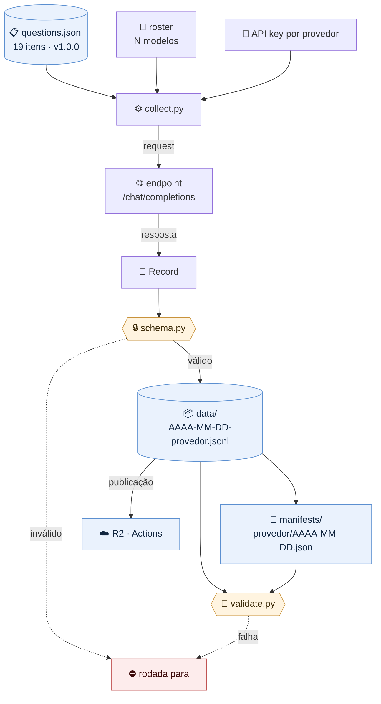

# ai-longitudinal-probe

**Coletor** do *Observatório Longitudinal de Modelos de IA em Produção*.

[](https://www.python.org/) [](LICENSE) [](AI_ASSISTANCE.md)

Uma bateria fixa de perguntas em português, disparada todo dia contra um roster fixo de modelos, com cinco
respostas por célula. O que sai é um arquivo append-only em que cada linha carrega a resposta literal e a
proveniência daquela chamada: modelo servido, rota, parâmetros, tokens, custo e latência.

Modelo não avisa quando muda: não há changelog para uma recusa que passou a aparecer. A única forma de saber
é perguntar a mesma coisa amanhã e guardar a resposta de ontem.

---

## Arquitetura



## Escopo

O coletor chama, valida e persiste, e nada além disso. Não dá nota, não ranqueia, não julga acerto, não
conclui: quem produz o dado não assina o veredito. Um coletor que também decide se auto-avalia.

LLM não tem saída tipada, então aqui ele não é tratado como classificador: não há prova, nem juiz automático,
nem "acertou". O que existe é **estrutura** (o que veio, quanto veio, quanto custou) e **mudança** (o que é
diferente de ontem).

## Trabalhos relacionados

Três projetos medem comportamento de modelo ao longo do tempo e são a referência direta daqui:

| projeto | escala | réplica intradiária |
|---|---|---|
| **Ask Me Twice** — Internet Archive + UC Berkeley, [JCDL 2026](https://doi.org/10.1145/3805696.3848492) | 267.706 respostas · 130 perguntas · 42 modelos · 62 dias | **não** (declara) |
| **LLM Election Observatory** — MIT, [llmelectionobservatory.org](https://www.llmelectionobservatory.org/) | 7 modelos · coleta a cada poucos dias · 2026 | **não** (temperatura default) |
| **LLMeval-Fair** — [arXiv 2508.05452](https://arxiv.org/abs/2508.05452) | 30 meses · ~60 modelos · 180k pontos | **não** (3 runs reamostram o banco) |

As três repetem a medição ao longo do tempo. Nenhuma repete a mesma célula no mesmo dia: o Ask Me Twice
declara no paper que registra uma resposta por célula em vez de réplicas intradiárias; o LLM Election
Observatory escolhe a temperatura default por realismo; o LLMeval-Fair faz três runs, mas reamostrando o
conjunto de questões, não a mesma pergunta.

A diferença importa porque a série sozinha não separa **mudança** de **azar amostral**. Sem repetir a
mesma célula, uma variação de um dia para o outro tem duas causas possíveis e nenhuma forma de
desempatá-las. Aqui as duas coisas rodam juntas — cinco draws por célula todo dia e a mesma bateria
repetida ao longo dos dias — e isso dá duas estimativas independentes de ruído, uma dentro do dia e uma
entre dias.

A terceira diferença é o idioma: as três são em inglês e sobre os Estados Unidos, e a [Carnegie](https://carnegieendowment.org/research/2026/08/llms-artificial-intelligence-longitudinal-monitoring-norms-politics-research) nomeia
idioma e geografia como o custo que limita o campo. A bateria daqui é em português, sobre fatos brasileiros.

## Bateria

| bloco | itens | o que é | exemplo |
|---|:---:|---|---|
| **F** — fato | 8 | fato estável (Ensino Fundamental e Brasil), com gabarito único | primeiro presidente do Brasil |
| **G** — geral | 4 | explicação aberta de conceito perene, sem resposta única | juros simples e compostos |
| **C** — calibração | 3 | premissa falsa ou cauda longa estável, com confiança declarada | final da Copa de 1942 |
| **K** — canário | 4 | resposta conhecida, testa encanamento, UTF-8, formato e premissa falsa | 17 + 25 |

Os canários não medem modelo nenhum: medem a coleta. Se um deles erra, o problema está no caminho entre a
pergunta e o arquivo, e o dia fica marcado como suspeito em vez de virar dado.

A bateria é aberta: perguntas, gabarito e fonte estão no repositório. Não é benchmark — nada aqui depende de
o modelo não ter visto a pergunta antes.

## Uso

```bash
uv sync --no-dev

# a chave vem do ambiente; sem ela, da Keychain do macOS
security add-generic-password -s PROBE_API_KEY -a "$USER" -w 'sk-...' -U

uv run python3 scripts/collect.py     # uma rodada de coleta
uv run python3 scripts/validate.py    # portão: sai 1 se o artefato não fechar

uv sync
uv run ruff check scripts tests && uv run pytest -q
```

## Configuração

| variável | default | o que é |
|---|---|---|
| `PROBE_API_KEY` | — | obrigatória. Lida do ambiente; se ausente, da Keychain do macOS (serviço `PROBE_API_KEY`) |
| `PROBE_KEYCHAIN_SERVICE` | `PROBE_API_KEY` | nome do serviço na Keychain, se quiser usar outro |
| `PROBE_BASE_URL` | `https://openrouter.ai/api/v1` | qualquer endpoint compatível com a API da OpenAI |
| `PROBE_DRAWS` | `5` | respostas por célula |
| `PROBE_MODELS` | roster do `collect.py` | ids separados por vírgula, do provedor que você apontar |
| `PROBE_RUN_DATE` | hoje em UTC-3 | `AAAA-MM-DD` |
| `PROBE_OUT` | `data/<data>.jsonl` | saída |
| `PROBE_MANIFEST_DIR` | `manifests` | manifesto |
| `PROBE_LIMIT_CALLS` | `400` | teto de chamadas da execução |
| `PROBE_SKIP_CANARIES` | — | `1` para deixar o bloco K de fora |

## GitHub Actions

`collect.yml` roda no cron das 05:17 BRT em matriz paralela por provedor (`openrouter` com `secrets.OPENROUTER_API_KEY`, `gemini` com `secrets.GEMINI_API_KEY` e `maritaca` com `secrets.MARITACA_API_KEY` rodando `S5-nano`), valida cada artefato com `validate.py` e publica os `.jsonl` brutos no Cloudflare R2 (via `secrets.BUCKET_API_KEY`, `secrets.BUCKET_ACCOUNT_ID` e `vars.BUCKET_NAME`), comitando os manifestos (com `file_sha256`) em `manifests/`. `ci.yml` roda lint e testes em push e PR.

Repositório público sem atividade por 60 dias tem o agendamento desativado. O commit diário do manifesto
é o que mantém o cron vivo.

## Declaração de uso de IA

O código, os testes e a documentação deste repositório foram escritos com assistência de IA generativa, sob
revisão humana linha a linha. Nenhum resultado empírico é produzido pela IA: as respostas do arquivo vêm de
chamadas HTTP a modelos de terceiros e são preservadas literalmente, incluindo as erradas.

A declaração completa — o que a IA fez, o que não fez e como verificar — está em
[AI_ASSISTANCE.md](AI_ASSISTANCE.md), conforme a Portaria CNPq nº 2.664/2026.

## Licença

Código sob [MIT](LICENSE). As respostas coletadas não são obra deste projeto: são saída de modelos de
terceiros, registradas com proveniência para que quem as use possa citar a origem.

---

A tese, os ADRs e a pesquisa de prior art vivem no container do projeto. Este repositório é a parte que roda.
